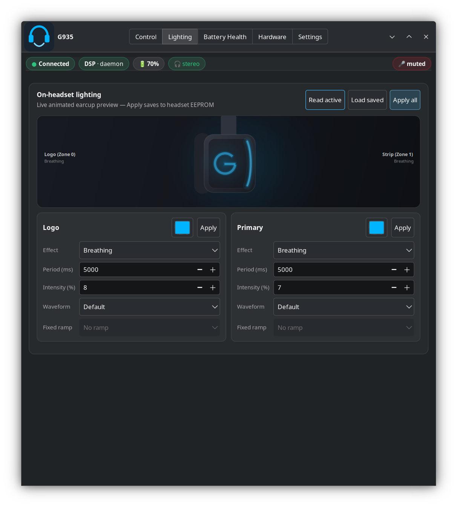
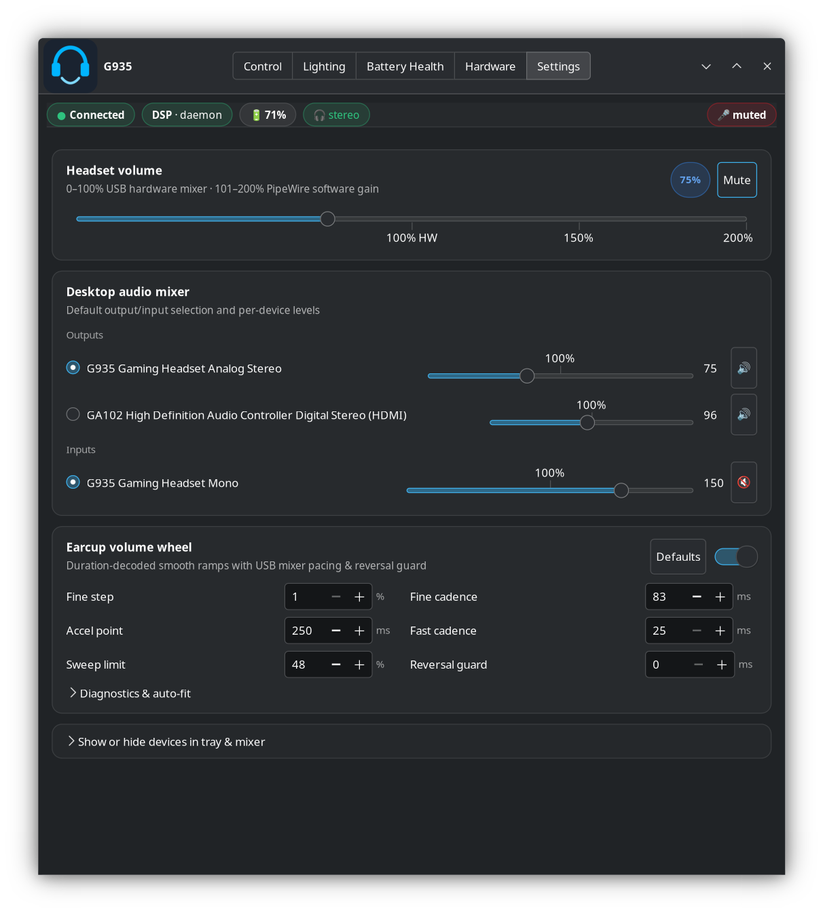

# g935-linux — full Logitech G935 control on Linux

A native GTK3 control panel and background service for the Logitech G935
wireless headset. It talks directly to the receiver over HID++—no G HUB,
Windows VM, or web account required.

[Latest release: v0.8.2](https://github.com/mattmattmatt1/g935-linux/releases/tag/v0.8.2)

## What's new in v0.8.2

**Volume stays on the headset.** Tray scroll, the earcup wheel, and G-key
volume and mute write the G935 sink (0–200%), including while that sink is
suspended. They use the default sink only when the headset node is gone. A
failed sink listing during a wheel spin no longer jumps to another device.

Also:

- Wheel-up on the tray icon is louder, one notch per 5%
- Volume and stream changes move the sliders and leave an open tray menu alone
- The tray still registers if Plasma’s status host is not up yet at login
- A second `--tray` start exits quietly when the panel is already running
- A rejected HID report is a timeout, not an unplug, so it does not look like a power cycle
- The daemon does not overwrite battery history while the panel is open

Upgrade from v0.8.1:

```bash
git pull --ff-only
./install.sh --user
systemctl --user restart g935-dsp.service
systemctl --user restart 'app-g935\x2dcontrol@autostart.service'
```

Udev does not need to be reinstalled.

### Earlier: v0.8.1

**Login tray autostart actually starts.** systemd’s XDG autostart generator
runs before `~/.local/bin` is on `PATH`, so `Exec=g935-control --tray` was
skipped (`Exec binary 'g935-control' does not exist`) and the tray icon never
appeared after reboot. `./install.sh --user` now writes an absolute `Exec=` /
`TryExec=` path.

Also:

- Wait for Plasma’s StatusNotifier host at login instead of skipping the tray
- `--tray` no longer dies on a hidraw permission dialog while seat ACLs catch up

Upgrade from v0.8:

```bash
git pull --ff-only
./install.sh --user
systemctl --user daemon-reload
```

Then log out/in, or start the tray now with `g935-control --tray`. Udev does
not need to be reinstalled for this fix.

### Earlier: v0.8

**G0–G3 bindings.** The bottom earcup mute button is G0; G1–G3 sit above it.
In software mode, tap defaults are next / play-pause / back / mic mute. Hold
(0.45s) is a second action. Media goes through Plasma’s keys, then MPRIS.
Hardware mode still uses G0 as on-device mute.

**Idle HID++ reads no longer steal the other process’s ACK.** The panel drain
path and the daemon’s leftover-report read take the same transaction lock as
`transact()`, so a busy hidraw cannot invent a power cycle. Presence debounce
from v0.7 stays as a backstop.

Also in v0.8:

- Tray icon on Plasma 6 Wayland (real app icon, `--tray`; login autostart
  landed in v0.8.1)
- HID++ feature/function probe (`tools/g935-probe.py`)
- Reconnect reapplies EQ in RAM only (explicit **Apply EQ** still writes EEPROM)
- The unmute pulse no longer blocks the daemon for 1.5s (wheel ramps keep moving)
- The panel starts without the receiver plugged in (settings and battery history)
- After login, the **daemon** retries hidraw `EACCES` until seat ACLs land
- The user unit starts after `graphical-session.target`
- udev grants `0660`/`plugdev` as a fallback next to `uaccess`
- The daemon logs battery samples when the panel is closed
- Console log is capped; earcup grab requires volume-key bits on the evdev node

First-time udev / `plugdev` (needed once, or when rules change):

```bash
./install.sh --udev          # then unplug/replug the receiver
sudo usermod -aG plugdev "$USER"   # once, if you are not already in plugdev
```

Log out/in (or reboot) after adding `plugdev`.

### Earlier: v0.7 presence / reconnect

False “headset offline” cycles from HID++ TIMEOUT under concurrent panel +
daemon traffic no longer re-trigger power-on DSP enable and lighting/EQ storms.
Presence debounce uses a longer miss streak and a post-connect grace window.
Software-mode DSP self-heal is rate-limited.

### Earlier: v0.6 low-battery notifications

Desktop toasts at **≤10%** (low) and **≤5%** (critical) while discharging;
silent while charging; re-check on unplug. Needs `libnotify-bin` and a running
panel.

## Earcup wheel (from v0.5)

The physical volume wheel feels like a real analog control instead of an
unpredictable media key. The receiver's press duration is decoded into smooth
1% changes: tiny movements stay precise, long sweeps accelerate progressively,
reversals are filtered, and wheel-up shares the 0–200% headset scale.

The tested balanced profile works out of the box. Six live comfort controls
let users tune fine adjustment, fine cadence, acceleration point, fast cadence,
maximum sweep distance, and reversal protection to taste. Calibration is no
longer required; raw capture and auto-fit remain available under collapsed
diagnostics for unusual hardware behavior.


## What it controls

- **Sound:** on-headset DSP soundstage, 10-band hardware EQ
  (32 Hz–16 kHz, ±12 dB), 18 categorized presets, and sidetone.
- **Microphone:** boom-up mute state, host mute recovery, mic-button handling
  (bottom earcup key), and daemon-backed auto-unmute in software mode.
- **G-keys:** bottom→top G0 (earcup mute button) … G3. Software-mode taps
  default to next / play-pause / back / mic mute. Hold is a second action.
  Hardware mode leaves G0 as on-device mute and G1–G3 on-headset.
- **Lighting:** independent controls for both RGB zones, including fixed,
  breathing, cycling, color, period, waveform, intensity, ramp, and boot
  animation where supported.
- **Battery:** live charge, voltage and runtime, learned drain history,
  estimated battery health, full-charge runtime loss, auto power-off, and
  desktop notifications at 10% (low) / 5% (critical) while discharging.
- **Desktop audio:** output/input visibility, default-device selection, tray
  mixer, and per-device volume. Headset volume is real Pulse/PipeWire percent
  on the G935 sink, 0–200%. 100% is hardware 0 dB; past that is software gain.
- **Earcup wheel:** short receiver presses become fine changes, while the
  longer held signal produced by a fast sweep is decoded into a continuous
  series of real 1% changes. Each sweep has a configurable 50% ceiling.
  Wheel, tray scroll, G-key volume, and sliders share the same 0–200% scale.
  USB-mixer writes are rate-limited and an oscillation circuit breaker freezes
  abusive rapid reversals before they can flood the headset hardware.
  Settings expose fine adjustment, fine cadence, acceleration point, fast
  cadence, sweep limit, and reversal protection, with the tested profile as
  the balanced default. An optional collapsed capture/auto-fit tool measures
  press duration, shows the raw timeline, saves every event for debugging, and
  can fit those controls to an individual wheel.
- **Hardware:** live firmware and feature discovery, G0–G3 events, reconnect
  recovery, automatic left-channel-only detection/repair, and an advanced
  HID++ console tucked into a collapsed section.

The panel only exposes controls the connected headset reports as supported.
EQ and lighting changes can be saved in headset memory.

## Screenshots

| Control | Lighting |
|---|---|
|  |  |
| **Battery Health** | **Settings** |
|  |  |

<details>
<summary>Tray menu</summary>


</details>

## ⚠️ Tested on exactly one setup

This has only been tested on:

- **Logitech G935** (wireless receiver, USB PID `0a87`)
- **Kubuntu / Ubuntu 26.04 LTS**, KDE Plasma 6.6 on **Wayland**, PipeWire
- Python 3.14

Anything else — other headsets, other distros, GNOME, X11, PulseAudio — is
uncharted. The code tries to degrade gracefully (features it can't discover are
hidden, unknown devices prompt before probing), but you're in test-pilot
territory. **Issues or success reports: hit me up on X
[@MatthewPhone](https://x.com/MatthewPhone)** or open a GitHub issue.

## Prerequisites

```bash
sudo apt install python3-gi gir1.2-gtk-3.0 gir1.2-ayatanaappindicator3-0.1 \
                 alsa-utils pulseaudio-utils pipewire-bin libnotify-bin
```

- `python3-gi` + GTK3 — the control panel
- `gir1.2-ayatanaappindicator3-0.1` — tray icon (optional; without it the app
  runs windowed)
- `alsa-utils` (`amixer`) — boom-mic mute handling in software mode
- `pulseaudio-utils` (`pactl`) — audio device pickers/volume (works with
  PipeWire's PulseAudio-compatible server too)
- `pipewire-bin` (`pw-link`) — detects and repairs the left-ear-only route
  that can appear after suspend
- `libnotify-bin` (`notify-send`) — desktop warnings for stereo-route breaks
  and low / critical battery while discharging
- `python3-hid` (or `pip install hid`) — only for the standalone
  `tools/g935-enable.py` hidapi path; the GUI and daemon don't need it

## Install or upgrade

### Fresh install

```bash
git clone https://github.com/mattmattmatt1/g935-linux.git
cd g935-linux

# Install the udev rule and mic-mute hwdb:
./install.sh --udev
# Unplug and reconnect the wireless receiver after this step.

# Install the panel, shared Python package, command, and user service:
./install.sh --user
# or: make install-user

# Launch:
g935-control
```

`./install.sh --user` also installs `~/.config/autostart/g935-control.desktop`
(absolute `Exec=` so systemd actually starts it). The next login puts the
panel in the tray (`g935-control --tray`). You can also run
`python3 g935-control.py` directly from the checkout.

### Upgrade an existing checkout

```bash
git pull --ff-only
./install.sh --user
systemctl --user daemon-reload
systemctl --user reenable --now g935-dsp
```

Quit and reopen the panel after upgrading. Re-running `--user` always matters:
it copies the shared `g935/` package and both launch scripts into
`~/.local/share/g935-linux/`.

**Udev** is needed once per machine and again when rules change (v0.8 adds a
`plugdev` fallback). If you installed before v0.5 and the earcup wheel cannot
open `/dev/input/event*`, or you are upgrading to v0.8, re-run:

```bash
./install.sh --udev
# then unplug and reconnect the wireless receiver
```

### Background service

Enable the user service for software-mode mic handling and automatic DSP
restoration whenever the headset powers on:

```bash
systemctl --user enable --now g935-dsp
```

The panel works without the service in hardware mode.

## The interface

| Page | What is there |
|---|---|
| **Control** | software/hardware mode, live G keys with bindings, sidetone, microphone state, 10-band EQ, and a compact categorized Presets menu |
| **Lighting** | independent Logo and Primary/Strip RGB effects and saved settings |
| **Battery Health** | power management first, prominent wear and time-lost summary, live ETA/drain, history, learned profile, and session quality |
| **Hardware** | firmware, discovered HID++ features, stereo-route state/repair, and the collapsed advanced console |
| **Settings** | tray/mixer device visibility, adaptive earcup-wheel calibration, and 0–200% headset volume (100% HW, then software gain) |

Scroll-wheel input passes over sliders normally until you click a slider once,
preventing accidental EQ, sidetone, or volume changes while scrolling a page.

## Volume: why 100% is quieter than Windows

Linux 100% on this headset is the USB mixer’s **0 dB** stop (`HW_VOLUME_CTRL`).
Windows G HUB adds extra digital gain on top, so the same “max” is louder there.

**Loudness is the G935 Pulse/PipeWire volume.** Raising HDMI/IEC958 does
nothing while you are listening on the headset. If you run EasyEffects in
front of the G935, lock that sink at 100% and keep using the G935 node as the
volume control — EasyEffects’ own volume is ignored on the monitor/filter
path, and this panel hides `easyeffects_*` devices so they are not mixed here.

To match Windows, set the **G935 sink** past 100%. PipeWire applies software
gain on that node (`channelVolumes` / `softVolumes`). 150% is about **+10.6 dB**.
The panel **Headset volume** bar, tray scroll, earcup wheel, and G-key volume
and mute all write that real percent, 0–200%. 100% is marked as hardware max;
the bar does not stop there.

```bash
# sanity check — this is the control that actually changes loudness
pactl set-sink-volume alsa_output.usb-Logitech_G935_Gaming_Headset-00.analog-stereo 150%
pactl get-sink-volume alsa_output.usb-Logitech_G935_Gaming_Headset-00.analog-stereo
```

Do not remap 0–100% UI onto 0–150% Pulse. That hid the extra range and made
the 100% mark a dead stop. Show the real Pulse percent past 100% instead.

Plasma’s own volume popup/OSD is separate. Enable **Raise maximum volume**
in System Settings → Sound if you want that popup to go past 100%. Plasma
hard-codes a **150%** cap (`PulseAudio.MaximalVolume`) and cannot show 200%.
Headset volume in this panel, the earcup wheel, G-key volume, and tray scroll
still go to 200%. This repo does not write `~/.config/plasmaparc`.

## The two modes

The headset has a mode switch (`11 ff 05 2b 01/00`) that changes more than sound.
**Default is hardware mode** (safe without the daemon). Flip the switch in the
GUI for software mode—the G HUB-style host-managed behavior.

| | **Hardware mode** (default) | **Software mode** |
|---|---|---|
| Sound | flat/narrow | DSP soundstage on |
| Boom mute | handled fully in firmware, just works | host must manage it (`g935-dspd`) |
| Mic button | works on-device | only emits an event (daemon handles it) |
| G0–G3 | G0 is on-device mute; G1–G3 stay on-headset | diverted HID++ events; software bindings |

Mode is stored in `~/.config/g935/mode` and re-asserted by the daemon on every
power-on. **If you use software mode, run the daemon.** Without it, raising the
boom mutes the mic and nothing will unmute it (the panel warns you).

### Who owns what

| Job | Daemon running | Daemon not running |
|---|---|---|
| Power-on DSP enable | **daemon**, with panel reassertion after confirmed reconnects | control panel |
| Boom mute / button | **daemon** | panel shows state only (Unstick button) |
| EQ / lighting / sidetone | control panel | control panel |
| Mode toggle (user switch) | panel writes mode file + command | same |

## Battery health

The Battery Health tab logs voltage samples while the panel is open and builds:

- **Battery wear and runtime lost per full charge** in a high-visibility summary
- **Live remaining runtime** from recent discharge datapoints
- **Expected vs actual** comparison against the rated runtime spec
- **Learned drain profile** (mV/h by voltage bin) and session history graphs

Data lives in `~/.config/g935/health.json`. The panel writes samples while it
is open. If the daemon is running and the panel is closed, the daemon records
the same voltage log so overnight / tray-less sessions still count. Health %
needs longer off-charger sessions (merged ≥30 min / ≥8% drop); short sessions
still feed live ETA and the profile. No coulomb counter exists — this is an
honest voltage-based extrapolation, not a BMS.

**While charging**, the headset ADC often reports the *charger path* (rail
spikes above 4.2 V), not resting cell voltage. The UI freezes SoC at the last
off-charger reading and shows path mV separately; full-charge peaks are taken
from rest after unplug, never from rail spikes.

**Low battery notifications** fire once per discharge cycle via `notify-send`
(notification tray): **low at ≤10%**, **critical at ≤5%**. Alerts are suppressed
while charging. Unplugging re-checks immediately (unplug at 8% → low; at 4% →
critical). Alerts also re-arm after SoC recovers past the threshold (with
hysteresis so ADC noise near the boundary does not spam).

### Left-ear-only after sleep

After suspend/resume, PipeWire/EasyEffects sometimes re-links only the left
channel into the G935 (`playback_FL`) and leaves the right port unconnected
(often named `playback_2`). The control panel checks every few seconds, shows
a **🎧 L-only** warning + banner, desktop-notifies, and auto-runs `pw-link` to
restore FR. Tray menu also gets **Fix stereo** while broken.

## Layout

| Path | Purpose |
|---|---|
| `g935-control.py` | GTK3 control panel |
| `g935-dspd.py` + `g935-dsp.service` | power-on watcher + software-mode mic daemon |
| `g935/` | shared library (HID++, mic, wheel, battery, audio, charts) |
| `99-g935.rules` | udev rule granting hidraw access |
| `70-g935-micmute.hwdb` | masks KEY_MICMUTE so the desktop stays out of software mode |
| `tools/` | research scripts (enable replay, sequence bisector) |
| `tests/` | offline unit tests (`make test`) |
| `install.sh` / `Makefile` | user + udev install (writes `~/.config/autostart/g935-control.desktop`) |
| `easyeffects-g935.json` | optional EasyEffects preset (software EQ route) |

## Troubleshooting

| Symptom | Fix |
|---|---|
| Permission denied on hidraw | `./install.sh --udev`, add yourself to `plugdev`, then replug the receiver |
| Daemon logs `permission denied` for ~1 min after login | upgrade to v0.8 or later; `systemctl --user reenable --now g935-dsp`. It waits for seat ACLs instead of failing the session |
| Tray icon missing (GNOME) | install AppIndicator extension, or run windowed |
| Tray icon missing (Plasma) | the icon is the **panel**, not the daemon. `./install.sh --user` then `g935-control --tray`. Login autostart uses an **absolute** `Exec=` path (`~/.local/bin/g935-control --tray`) because systemd’s autostart generator does not search `PATH`. Look in the tray overflow (▲) if Application Status is hidden |
| Mic stuck muted after boom up | enable daemon: `systemctl --user enable --now g935-dsp`, or switch to hardware mode |
| "press unmute twice" | install `70-g935-micmute.hwdb` via `./install.sh --udev` |
| Sound flat after power cycle | daemon not running, or mode is hardware — enable daemon / flip software mode |
| Headset flickers offline / DSP re-enables every ~15–60s | upgrade to v0.8 or later; `./install.sh --user` and `systemctl --user reenable --now g935-dsp`, then reopen the panel |
| Only the left ear works after sleep | install `pipewire-bin`; the panel should detect and repair the missing right-channel link |
| Panel dead after unplug/replug | should auto-recover; if not, restart the panel (file a bug) |
| Panel will not start with the dongle unplugged | upgrade to v0.8 or later — settings and battery history open offline |
| `g935-control: command not found` | ensure `~/.local/bin` is on `PATH`, or run `python3 g935-control.py` |
| Desktop file won’t launch from file manager | use the installed `g935-control` command / app menu entry, not the raw `.desktop` in the git checkout |

## Development

```bash
make test       # offline unit tests
make compile    # bytecode compile check
```

Research tools (fixed feature indices from 2026-07 captures; GUI discovers live):

```bash
python3 tools/g935-enable-v2.py   # full cold-connect with ACK/ERR
python3 tools/g935-step.py        # interactive sequence bisector
python3 tools/g935-probe.py       # GET-only feature/function sweep
python3 tools/g935-probe.py --dry-run
python3 tools/g935-probe.py --followup --unlock-hidden
```

`g935-probe.py` walks `IFeatureSet`, asks `IRoot getFeature` for a curated
ID catalog (including `0x8320` Headset Out and `0x1E00` Enable Hidden
Features), then sweeps functions `0–15` on each live feature. Known SET
and DFU writes are skipped so zero-padded reports cannot flip software
mode or write EQ/lighting. `--wide` / `--full` expand the ID space;
`--unlock-hidden` is the only opt-in SET. See `notes/PROBE.md`.

## License

[PolyForm Noncommercial 1.0.0](LICENSE) — free to use, modify, and share for
any noncommercial purpose. **Commercial use (including selling this or
products built on it) requires a separate license — contact
[@MatthewPhone](https://x.com/MatthewPhone) on X.**

## Credits / prior art

- [g933-utils](https://github.com/ashkitten/g933-utils) — HID++ groundwork on
  the sibling G933
- [HeadsetControl](https://github.com/Sapd/HeadsetControl) — sidetone/battery
  for many headsets, including this one
