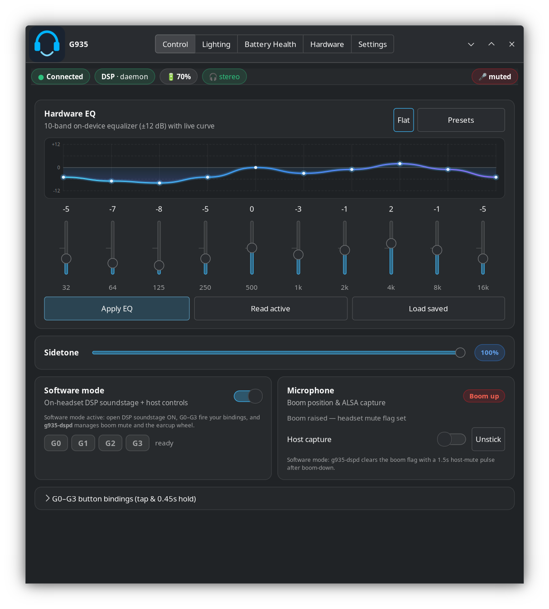
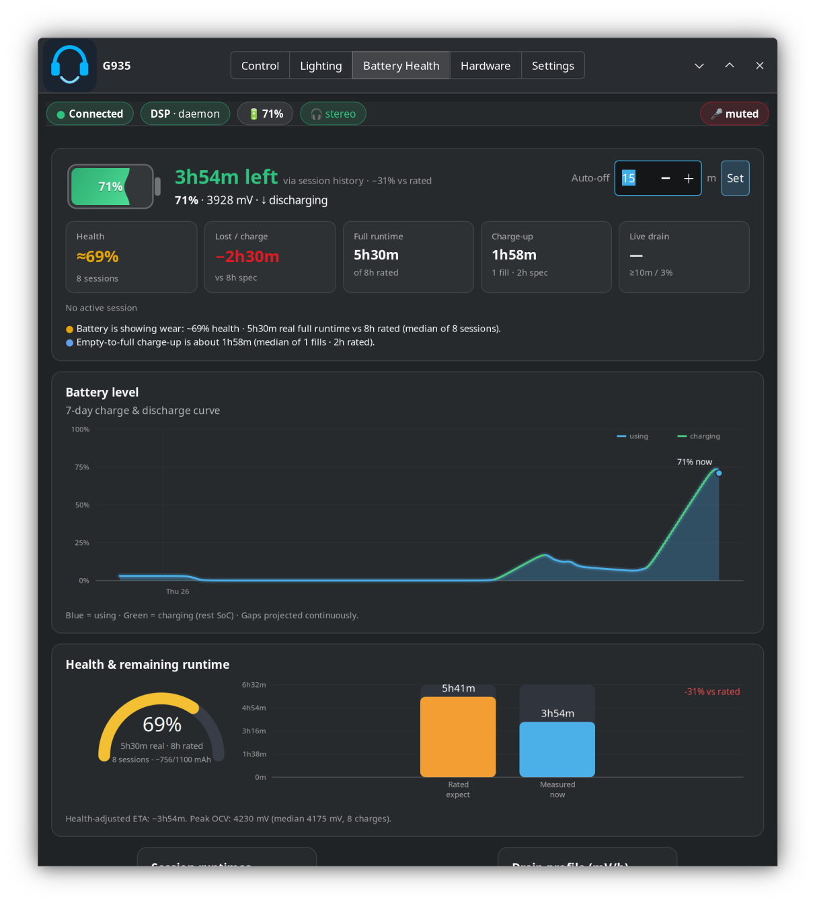
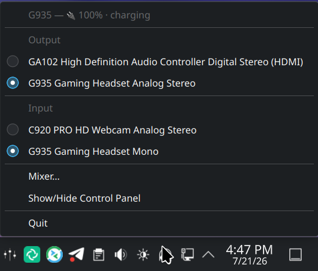
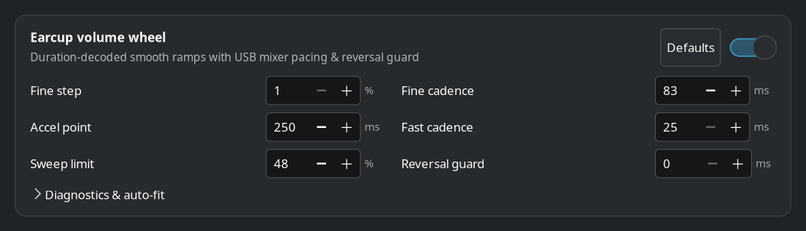

# g935-linux — full Logitech G935 control on Linux

A native GTK3 control panel and single-owner background daemon for the
**Logitech G935** wireless headset on Linux. It talks directly to the USB
receiver over HID++—no G HUB, Windows VM, or cloud account required.

[Latest release: v0.9.0](https://github.com/mattmattmatt1/g935-linux/releases/tag/v0.9.0)

## Screenshots

| Control | Lighting |
|---|---|
|  |  |
| **Battery Health** | **Settings** |
|  |  |

<details>
<summary>Tray menu</summary>



</details>

## What's new in v0.9.0

**Single-owner daemon, native `libpulse` audio, wheel lockup fixes, and a redesigned UI.**

- **No more earcup-wheel reversal lockups:** Rewrote wheel pacing around a
  post-write USB-mixer cooldown, 2% coalescing, 60 ms reversal settle,
  same-buffer reversal cancellation, and held-reversal burst detection so rapid
  up/down reversals can no longer freeze the headset or PipeWire mixer.
- **Single-owner hardware daemon (`g935-dspd`):** The daemon now exclusively
  owns `/dev/hidraw*`, `/dev/input/event*`, battery logging (`health.json`),
  low-battery notifications, and headless G0–G3 tap/hold bindings. The GTK3
  panel connects over a local UNIX JSON-RPC + event stream socket
  (`$XDG_RUNTIME_DIR/g935-dspd.sock`, mode `0600`), eliminating cross-process
  HID++ collisions and write races. If the daemon isn't running, the panel
  transparently falls back to direct `hidraw`.
- **Native `libpulse` client (`g935/pulse.py`):** Volume reads, writes, mute
  toggles, and topology subscriptions talk directly to PipeWire/PulseAudio over
  `ctypes` (`libpulse.so.0`, zero external Python packages) instead of spawning
  `pactl` subprocesses on every tick, with transparent `pactl` fallback.
- **Redesigned modular GTK3 UI (`g935/ui/`):**
  - **Control:** 10-band Hardware EQ promoted to the top with a live smooth
    Cairo frequency-response curve, followed by sidetone, a compact side-by-side
    Software Mode + Microphone row, and collapsible G0–G3 bindings.
  - **Lighting:** Live animated G935 earcup RGB preview (Zone 0 G-logo + Zone 1
    front strip) responding in real time to mode, color, period, intensity, and
    all 7 breathing waveforms before hitting **Apply**.
  - **Battery Health:** Animated battery dashboard with ETA, 5 live KPI tiles,
    and the 7-day charge curve immediately above the fold.
  - **Zero idle churn:** Animations and heavy 7-day battery analytics only run
    when the window is visible **and** their respective tab is active.
- **Reliability fixes:** Stale `hidraw` reply draining and `EAGAIN`/`EINTR`
  write retries, event-driven `select()` wakeup pipe in `HidWorker`, DST-safe
  chart midnight ticks, Plasma notification replace-ID tracking (`--print-id`),
  and charging-rail debounce hardening.

### Upgrade from v0.8.x

```bash
git pull --ff-only
./install.sh --user
systemctl --user daemon-reload
systemctl --user restart g935-dsp.service
systemctl --user restart 'app-g935\x2dcontrol@autostart.service'
```

Udev does not need to be reinstalled if you already installed v0.8 rules.

---

## Architecture

```
                         ┌──────────────────────────────────────────────┐
                         │           g935-dspd (user service)           │
  /dev/hidraw* ◄────────►│  • Single HID++ 2.0 owner & event reader     │
  /dev/input/event* ────►│  • Earcup wheel decoder & reversal guard     │
                         │  • Boom-mic unmute pulse & headless G0–G3    │
  PipeWire / Pulse ◄────►│  • Native libpulse client (pactl fallback)   │
  ~/.config/g935/ ◄─────►│  • Battery sampler, health.json, alerts      │
                         └──────────────────────┬───────────────────────┘
                                                │
                         UNIX socket (0600): $XDG_RUNTIME_DIR/g935-dspd.sock
                         Line-delimited JSON-RPC + broadcast event stream
                                                │
                         ┌──────────────────────▼───────────────────────┐
                         │         g935-control (GTK3 + tray)           │
                         │  • DeviceClient (daemon-first, direct        │
                         │    hidraw fallback when daemon is stopped)   │
                         │  • Modular pages + Cairo live visuals        │
                         │  • PipeWire stereo-route watcher & repair    │
                         └──────────────────────────────────────────────┘
```

- **Zero external Python dependencies:** Everything uses Python's standard
  library plus system `python3-gi` (GTK3/Cairo) and `libpulse.so.0` via
  `ctypes`.
- **Single source of truth for hardware & health logs:** Because `g935-dspd`
  serializes all HID++ transactions and owns `~/.config/g935/health.json`,
  opening or closing the panel never races with background battery sampling,
  power-on DSP restoration, or boom-mic handling.
- **IPC methods (`g935/daemon_ipc.py`):** `get_state`, `hidpp`, `set_mode`,
  `pause_wheel` (client-scoped for calibration), `update_health_settings`, and
  `set_host_mic`, paired with server-pushed `battery`, `presence`, `mode`,
  `mic`, `boom`, `hidpp_event`, and `link` events.

---

## What it controls

- **Sound & EQ:** 10-band on-device hardware EQ (32 Hz–16 kHz, ±12 dB) with a
  live response curve, 18 categorized presets, on-headset DSP soundstage toggle,
  and sidetone (0–100%).
- **Microphone:** Live boom-up/down status, ALSA host capture switch, one-click
  unstick, and daemon-managed auto-unmute in software mode.
- **G-keys (G0–G3):** Bottom→top `G0` (earcup mute button) through `G3`. In
  software mode, tap defaults are next / play-pause / previous / mic mute, with
  a configurable second action on 0.45 s hold. Works even when the panel is
  closed as long as `g935-dspd` is running.
- **Lighting:** Live animated earcup preview plus independent controls for both
  RGB zones (Logo & Strip): Off, Fixed, Breathing (7 waveforms), Cycling,
  color, period, intensity, ramp, and boot animation where supported.
- **Battery Health:** Animated live battery readout, ETA, wear %, runtime lost
  per full charge, 7-day charge/discharge curve, expected vs. actual runtime,
  learned drain profile (mV/h by voltage bin), session history, auto power-off
  timeout, and desktop notifications at **≤10%** (low) and **≤5%** (critical)
  while discharging.
- **Desktop audio & headset volume:** Output/input visibility, default-device
  switching, tray mixer, and real PipeWire/PulseAudio 0–200% volume on the G935
  sink (0–100% USB hardware mixer, 101–200% software gain).
- **Earcup wheel:** Smooth duration-decoded ramps on the 0–200% headset scale
  with USB-mixer pacing, reversal guard, 6 live comfort controls, and a
  collapsible raw capture / auto-fit diagnostics tool.
- **Hardware & diagnostics:** Live firmware & HID++ feature discovery, control
  link status (daemon vs. direct), automatic left-ear-only PipeWire stereo
  detection/repair, and a collapsed raw HID++ console.

The panel only exposes controls the connected headset reports as supported.
Explicit **Apply** saves EQ and lighting into headset EEPROM; reconnects
re-apply RAM state only.

## Earcup wheel

The physical volume wheel feels like a smooth analog control instead of a
jumpy media key. Short receiver presses make precise 1% steps, longer sweeps
accelerate progressively up to a configurable sweep ceiling, and rapid
up/down reversals are damped before they can flood the USB mixer.



## The interface

| Page | What is there |
|---|---|
| **Control** | 10-band Hardware EQ with live frequency-response curve and categorized presets at the top, followed by sidetone, side-by-side Software Mode & Microphone cards, and collapsible G0–G3 tap/hold bindings |
| **Lighting** | Live animated G935 earcup RGB preview (Logo + Strip) above side-by-side zone controls and EEPROM Read/Load/Apply actions |
| **Battery Health** | Animated battery dashboard with ETA, auto-off, and 5 KPI tiles, 7-day battery curve above the fold, health gauge + expected-vs-actual bars, session & drain charts, and collapsible spec/tracking settings |
| **Hardware** | Firmware, discovered HID++ features, control-link transport, stereo-route status/repair, and collapsed raw HID++ console |
| **Settings** | 0–200% headset volume bar, desktop audio mixer, earcup-wheel comfort controls (with collapsible diagnostics/auto-fit), and collapsible tray/mixer device visibility |

Scroll-wheel input passes over sliders normally until you click a slider once,
preventing accidental EQ, sidetone, or volume changes while scrolling a page.

---

## Tested environment

This project is actively tested on:

- **Logitech G935** (wireless USB receiver, PID `046d:0a87`)
- **Kubuntu / Ubuntu 26.04 LTS**, KDE Plasma 6.6 on **Wayland**, PipeWire 1.6
- Python 3.14 (unit tests also verified in CI on Python 3.12)

Other headsets, distros, GNOME, X11, or classic PulseAudio should degrade
gracefully (undiscovered features hide automatically, unknown devices prompt
before probing), though they are less tested. **Issues or success reports:**
open a GitHub issue or reach out on X [@MatthewPhone](https://x.com/MatthewPhone).

## Prerequisites

```bash
sudo apt install python3-gi gir1.2-gtk-3.0 gir1.2-ayatanaappindicator3-0.1 \
                 alsa-utils pulseaudio-utils pipewire-bin libnotify-bin
```

- `python3-gi` + `gir1.2-gtk-3.0` — GTK3 control panel and Cairo charts/visuals
- `gir1.2-ayatanaappindicator3-0.1` — system tray icon (optional; runs windowed without it)
- `alsa-utils` (`amixer`) — boom-mic ALSA capture switch handling in software mode
- `libpulse0` / `pulseaudio-utils` — native `libpulse` audio control with `pactl` fallback
- `pipewire-bin` (`pw-link`) — detects and repairs left-ear-only routes after suspend
- `libnotify-bin` (`notify-send`) — desktop warnings for stereo-route breaks and low/critical battery
- `python3-hid` — only needed for standalone research scripts in `tools/`; not used by the panel or daemon

## Install or upgrade

### Fresh install

```bash
git clone https://github.com/mattmattmatt1/g935-linux.git
cd g935-linux

# 1. Install udev rule (hidraw/input access) and mic-mute hwdb:
./install.sh --udev
sudo usermod -aG plugdev "$USER"   # once, if not already in plugdev
# Unplug and replug the wireless receiver (and log out/in if plugdev was added).

# 2. Install the package, CLI entrypoints, user service, and login tray autostart:
./install.sh --user
# (or: make install-user)

# 3. Enable the single-owner background daemon:
systemctl --user enable --now g935-dsp

# 4. Launch the control panel:
g935-control
```

`./install.sh --user` installs `~/.config/autostart/g935-control.desktop` with
an absolute `Exec=` path so systemd's XDG autostart generator launches the tray
icon cleanly at login (`g935-control --tray`). You can also run
`python3 g935-control.py` directly from a checkout.

### Upgrade an existing checkout

```bash
git pull --ff-only
./install.sh --user
systemctl --user daemon-reload
systemctl --user restart g935-dsp.service
systemctl --user restart 'app-g935\x2dcontrol@autostart.service'
```

Re-running `./install.sh --user` refreshes `~/.local/share/g935-linux/`
(including all `g935/` and `g935/ui/` modules) and both `~/.local/bin/`
launchers. Re-run `./install.sh --udev` only when `99-g935.rules` or
`70-g935-micmute.hwdb` changes.

---

## Volume: why 100% is quieter than Windows

Linux 100% on the G935 is the USB mixer's **0 dB** stop (`HW_VOLUME_CTRL`).
Windows G HUB adds extra digital gain on top, so "100%" is louder there.

**Loudness lives on the G935 PipeWire/PulseAudio sink.** Raising HDMI or
analog speakers does nothing while listening on the headset. If you place
EasyEffects in front of the G935, leave EasyEffects at 100% and adjust the
G935 node itself (`easyeffects_*` nodes are hidden from this panel).

To match Windows loudness, slide the **G935 sink** past 100% (PipeWire applies
software gain; 150% is roughly **+10.6 dB**). The panel's **Headset volume**
slider, tray scroll, earcup wheel, and G-key volume actions all operate on that
real 0–200% scale with a clear `100% HW` marker.

```bash
# Sanity check — this is the node that actually controls loudness:
pactl set-sink-volume alsa_output.usb-Logitech_G935_Gaming_Headset-00.analog-stereo 150%
pactl get-sink-volume alsa_output.usb-Logitech_G935_Gaming_Headset-00.analog-stereo
```

Plasma's built-in volume OSD caps display at 150% (`PulseAudio.MaximalVolume`,
once **Raise maximum volume** is enabled in System Settings → Sound), while
`g935-control`, the earcup wheel, tray scroll, and G-keys still reach 200%.

## The two modes

The headset exposes a firmware mode switch (`11 ff 05 2b 01/00`) that governs
both audio processing and button routing. **Default is hardware mode** (safe
without the daemon). Flip **Software mode** on the Control page for the
G HUB-style host-managed mode.

| | **Hardware mode** (default) | **Software mode** |
|---|---|---|
| Sound | Flat / narrow | On-headset DSP soundstage ON |
| Boom mute | Handled in firmware | Host-managed by `g935-dspd` |
| Mic button | On-device mute | Diverted as `G0` tap/hold |
| G1–G3 | On-headset macros | Diverted HID++ events (`G1`–`G3` bindings) |

Mode is persisted in `~/.config/g935/mode` and re-asserted by `g935-dspd` on
every power-on. **Run `g935-dspd` whenever using software mode** — without it,
raising the boom mutes the mic and nothing clears the latch.

### Who owns what

| Job | Daemon running (`g935-dspd`) | Standalone (no daemon) |
|---|---|---|
| `/dev/hidraw*` & `/dev/input/event*` | **daemon** (single hardware owner; panel connects over `$XDG_RUNTIME_DIR/g935-dspd.sock`) | control panel (direct `hidraw` fallback) |
| Power-on DSP enable & boom mute | **daemon** | control panel (no software auto-unmute) |
| Earcup wheel & headless G0–G3 bindings | **daemon** (native `libpulse` with `pactl` fallback) | panel handles G0–G3 while open |
| Battery logging & low-battery alerts | **daemon** (streams live updates to panel) | control panel |
| EQ / lighting / sidetone / mode switch | panel via daemon IPC | control panel |

## Battery health & stereo repair

### Voltage-based battery health

`g935-dspd` logs voltage samples continuously to `~/.config/g935/health.json`
(even with the panel closed) and streams live readings to the panel:

- **Wear & runtime lost per full charge** from longer off-charger sessions
  (merged ≥30 min / ≥8% drop; short sessions still feed live ETA and drain bins)
- **Live remaining runtime** and **expected vs. actual** bars against the
  rated spec (8 h RGB on / 12 h RGB off, customizable)
- **7-day charge & discharge curve** and **learned drain profile** (mV/h)

Because the G935 has no coulomb counter, this is an honest voltage-based
extrapolation. While charging, the ADC frequently reads the **charger rail**
(>4.2 V) rather than resting cell voltage — the tracker holds SoC at the last
off-charger reading, shows charger path mV separately, and only records
full-charge peaks from post-unplug rest.

**Low-battery notifications** fire once per discharge cycle via `notify-send`
at **≤10%** (low) and **≤5%** (critical), stay silent while charging, re-check
immediately on unplug, and use hysteresis + server-assigned notification IDs so
Plasma never logs stale replace-ID warnings.

### Left-ear-only after sleep

After suspend/resume, PipeWire/EasyEffects sometimes re-links only the left
channel (`playback_FL`) into the G935 and leaves the right channel (often
`playback_2`) unlinked. The control panel monitors the graph, shows a
**🎧 L-only** chip and banner, sends a notification, and automatically calls
`pw-link` to restore stereo.

---

## Repository layout

| Path | Purpose |
|---|---|
| `g935-control.py` | GTK3 control panel (daemon-first client with direct `hidraw` fallback) |
| `g935-dspd.py` + `g935-dsp.service` | Single-owner hardware daemon (HID++, wheel, boom mute, headless G-keys, battery log, UNIX JSON-RPC) |
| `g935/` | Core library: `hidpp.py`, `pulse.py`, `daemon_ipc.py`, `device_client.py`, `volume_wheel.py`, `audio.py`, `battery.py`, `charts.py`, `bindings.py`, `features.py`, `mic.py`, `stereo_route.py`, `mode.py`, `app_settings.py` |
| `g935/ui/` | Modular GTK3 UI: `control_page.py`, `lighting_page.py`, `battery_page.py`, `hardware_page.py`, `settings_page.py`, `visuals.py`, `lighting_math.py`, `theme.py`, `tray.py`, `wheel_calibration.py` |
| `99-g935.rules` | udev rule granting `uaccess` + `plugdev` access to receiver `hidraw` and `input` nodes |
| `70-g935-micmute.hwdb` | Masks `KEY_MICMUTE` so the desktop does not double-toggle mic mute in software mode |
| `tools/` | Research & protocol utilities (`g935-probe.py`, `g935-enable-v2.py`, `g935-step.py`) |
| `tests/` | Offline unit test suite (`make test`, 200+ pure-stdlib tests) |
| `install.sh` / `Makefile` | User & udev installer + test/compile targets |
| `easyeffects-g935.json` | Optional EasyEffects preset |

## Troubleshooting

| Symptom | Fix |
|---|---|
| Permission denied on `hidraw` / `input` | `./install.sh --udev`, `sudo usermod -aG plugdev "$USER"`, replug receiver (and re-login if newly added to `plugdev`) |
| Daemon logs `permission denied` briefly after login | Normal for a few seconds while seat ACLs settle; `g935-dspd` retries automatically |
| Tray icon missing (Plasma) | The tray icon belongs to `g935-control --tray`, not `g935-dspd`. Run `./install.sh --user` so autostart has an absolute `Exec=` path, and check the tray overflow (▲) |
| Tray icon missing (GNOME) | Install an AppIndicator extension, or run windowed |
| Mic stuck muted after boom up | Ensure `g935-dspd` is active (`systemctl --user enable --now g935-dsp`), or switch to hardware mode |
| "Press unmute twice" | Install `70-g935-micmute.hwdb` via `./install.sh --udev` |
| Sound flat after power cycle | Enable `g935-dsp` and toggle **Software mode** on |
| Only the left ear works after sleep | Install `pipewire-bin`; the panel detects and repairs the missing right link automatically |
| `g935-control: command not found` | Add `~/.local/bin` to `PATH`, or run `python3 g935-control.py` |

## Development

```bash
make test       # offline unit tests (pure stdlib; runs identically in CI)
make compile    # bytecode compile check
```

Research tools (fixed feature indices from captures; the GUI discovers live):

```bash
python3 tools/g935-enable-v2.py             # cold-connect sequence replay with ACK/ERR
python3 tools/g935-step.py                  # interactive sequence bisector
python3 tools/g935-probe.py --dry-run       # GET-only feature/function sweep
python3 tools/g935-probe.py --followup --unlock-hidden
```

<details>
<summary>Earlier release notes (v0.8.2 → v0.5)</summary>

- **v0.8.2:** Keep volume on the G935 sink (including while suspended); tray
  scroll 5% per notch; wait for Plasma StatusNotifier host; quiet duplicate
  `--tray` exit; protect battery history from concurrent writes.
- **v0.8.1:** Absolute `Exec=`/`TryExec=` in login autostart `.desktop` so
  systemd starts the tray after reboot; quiet hidraw permission wait on `--tray`.
- **v0.8:** G0–G3 tap/hold bindings; `hidraw` transaction locking; Plasma 6
  Wayland tray icon; HID++ probe tool; RAM-only EQ on reconnect; non-blocking
  boom unmute pulse; offline panel startup; `plugdev` udev fallback; daemon-side
  battery logging.
- **v0.7:** Presence debounce and reconnect grace window; rate-limited DSP
  self-heal.
- **v0.6:** Low (≤10%) and critical (≤5%) discharging battery notifications.
- **v0.5:** Smooth duration-decoded earcup volume wheel with acceleration and
  comfort controls.

</details>

## License

[PolyForm Noncommercial 1.0.0](LICENSE) — free to use, modify, and share for
any noncommercial purpose. **Commercial use (including selling this or
products built on it) requires a separate license — contact
[@MatthewPhone](https://x.com/MatthewPhone) on X.**

## Credits / prior art

- [g933-utils](https://github.com/ashkitten/g933-utils) — HID++ groundwork on
  the sibling G933
- [HeadsetControl](https://github.com/Sapd/HeadsetControl) — sidetone/battery
  for many headsets, including this one
